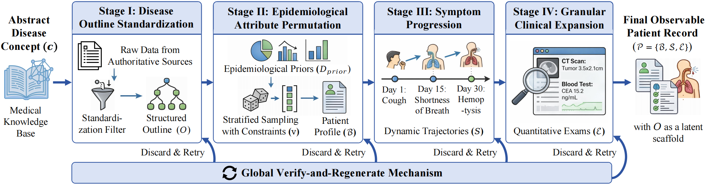
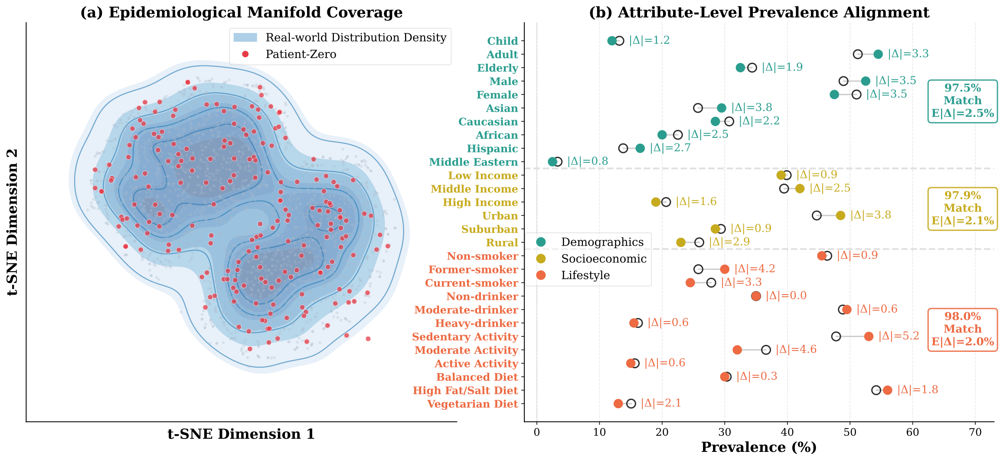
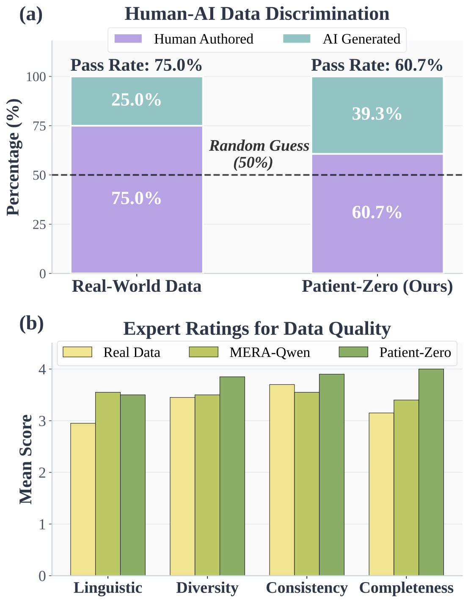

# Patient-Zero: Scaling Synthetic Patient Agents to Real-World Distributions without Real Patient Data

<p align="center">
  <a href="https://aclanthology.org/2026.emnlp-main.1149/">
    
  </a>
  <a href="https://aclanthology.org/2026.emnlp-main.1149.pdf">
    
  </a>
  <a href="data/">
    
  </a>
  <a href="LICENSE">
    
  </a>
</p>

> 🎉 **Published at EMNLP 2026!** Explore our release of **4,064 synthetic patient records** across six clinical specialties. The paper is available on [ACL Anthology](https://aclanthology.org/2026.emnlp-main.1149/).

**Patient-Zero** is a framework for creating synthetic patient records and interactive patient agents from medical knowledge. It combines structured record synthesis with a cognitive memory system to support diverse patient profiles and consistent clinical conversations, without using real patient records as generation seeds.

**Yunghwei Lai, Ziyue Wang, Weizhi Ma, and Yang Liu** · Tsinghua University

This is the official repository for the paper. The current release contains the patient-record subset in [`data/`](data/).

<p align="center">
  
</p>
<p align="center"><em>Medically-Aligned Hierarchical Synthesis with a global verify-and-regenerate mechanism.</em></p>

## 📰 News

- **[Nov 2026]** 🚀 **Dataset release:** 4,064 synthetic patient records are available as six JSONL files, covering 98 distinct disease labels.
- **[Oct 2026]** 🎉 **EMNLP 2026:** Patient-Zero is published in the *Proceedings of the 2026 Conference on Empirical Methods in Natural Language Processing*. Read the [paper](https://aclanthology.org/2026.emnlp-main.1149/).

## ✨ Key Features

- **Generation from Medical Knowledge:** Builds patient records from medical knowledge and demographic priors, enabling controlled variation in patient characteristics.
- **Medically-Aligned Hierarchical Synthesis:** Combines attribute sampling, structured generation, deterministic clinical checks, and semantic verification to construct profiles, symptoms, and examination findings.
- **Dual-Track Cognitive Memory:** Maintains persistent patient information alongside evolving interaction memory to support factual consistency and persona adherence during clinical inquiries.
- **Evaluation across Multiple Settings:** The paper studies record quality, patient-agent interaction, physician assessments, medical education, and downstream medical reasoning.

## 📦 Dataset

The paper describes a corpus of **60,000 records across six specialties and 98 disease types**. This repository provides a **4,064-record subset** generated with GPT-4.1 (`gpt-4.1-2025-04-14`).

| Specialty | Records | Download |
| :--- | ---: | :--- |
| Cardiology | 1,000 | [Cardiology.jsonl](data/Cardiology.jsonl) |
| Gastroenterology | 1,000 | [Gastroenterology.jsonl](data/Gastroenterology.jsonl) |
| General Surgery | 30 | [General_Surgery.jsonl](data/General_Surgery.jsonl) |
| Neurology | 1,000 | [Neurology.jsonl](data/Neurology.jsonl) |
| Psychiatry | 34 | [Psychiatry.jsonl](data/Psychiatry.jsonl) |
| Pulmonology | 1,000 | [Pulmonology.jsonl](data/Pulmonology.jsonl) |
| **Total** | **4,064** | |

The release target is 1,000 records per specialty. General Surgery and Psychiatry are absent from the selected v2 source; this release includes all **30** and **34** available v1 records, respectively. These two specialties remain **970** and **966** records short of that target. All records are included without replacement.

<details>
<summary><strong>Data sources and sampling</strong></summary>

The four 1,000-record specialties come from `hierarchical-v2/gpt-4.1-2025-04-14/`. General Surgery and Psychiatry come from `hierarchical-v1/gpt-4.1-2025-04-14-old/`. Both paths are relative to the original project's `outputs/merge/` directory.

Selection is stratified by `disease` and `severity`, with proportional quotas allocated using the largest remainder method. Within each stratum, records are ranked by the SHA-256 hash of `seed + NUL + specialty + NUL + record_id`, using seed **42**. Output records retain source line order.

Original record fields, disease assignments, and text are preserved with LF line endings. No additional clinical filtering was applied during subset preparation.

</details>

## 🛠️ Installation & Usage

Clone the repository:

```bash
git clone https://github.com/thu-unicorn/Patient-Zero.git
cd Patient-Zero
```

Each file in `data/` is UTF-8 JSON Lines, with one patient record per line. You can load all six specialties using the Python standard library:

```python
import json
from pathlib import Path

records_by_specialty = {}
for path in sorted(Path("data").glob("*.jsonl")):
    with path.open(encoding="utf-8") as handle:
        records_by_specialty[path.stem] = [json.loads(line) for line in handle]

for specialty, records in records_by_specialty.items():
    print(f"{specialty}: {len(records)} records")

assert sum(map(len, records_by_specialty.values())) == 4064
```

<details>
<summary><strong>Record format</strong></summary>

Specialty is identified by the filename. Each record preserves the following source fields:

| Fields | Content |
| :--- | :--- |
| `name`, `gender`, `age` | Synthetic patient identity and demographics |
| `disease`, `severity` | Disease label and severity |
| `symptom` | Symptoms and duration |
| `examination_results` | Examination names and generated findings |
| `medical_history`, `lifestyle_factor`, `vaccination_history`, `family_history` | History and background lists |
| `profile` | Structured demographic and disease-specific attributes |
| `record_id`, `generated_at` | Original generation identifier and timestamp |

</details>

## 🏆 Main Results

The following results are reported in the [paper](https://aclanthology.org/2026.emnlp-main.1149/) and refer to its full experimental setup. The downloadable subset above contains 4,064 records.

<p align="center">
  
</p>
<p align="center"><em>Distribution analysis from the paper: epidemiological coverage and attribute-level prevalence alignment.</em></p>

**Downstream medical reasoning (Table 3).** Training with Patient-Zero data improves Qwen3-8B on both evaluated benchmarks.

| Model | MedQA (%) | MMLU (%) |
| :--- | :---: | :---: |
| Qwen3-8B (Base) | 61.00 | 69.50 |
| Qwen3-8B + Patient-Zero | **85.00** | **83.00** |

**Patient-agent interaction (Table 2).** The memory system supports consistency and resistance to misleading suggestions during multi-turn clinical inquiries.

| Metric | Without Dual-Track Cognitive Memory | Patient-Zero |
| :--- | :---: | :---: |
| Logical consistency ↑ | 81.36 | **100.00** |
| Factual recall ↑ | 7.88 | **33.27** |
| Persona alignment ↑ | 61.10 | **83.70** |
| Stylistic stability ↑ | 46.61 | **75.50** |
| Hallucination rate ↓ | 10.45 | **1.82** |
| Inducibility resistance ↑ | 69.17 | **97.22** |

## 👥 Human Evaluation

In the paper's blinded physician evaluation, Patient-Zero receives mean ratings of **3.85/5 for diversity**, **3.90/5 for consistency**, and **4.00/5 for completeness** (Table 14).

<p align="center">
  
</p>
<p align="center"><em>Human evaluation: record-source discrimination and expert ratings of data quality.</em></p>

A separate study with **16 medical students** reports positive perceptions of educational usefulness, including **6.31/7** for providing a low-risk practice environment and **6.06/7** for teaching-tool utility. These ratings measure perceived usability and educational value.

## 🔬 Ablation Studies

- **Hierarchical Synthesis:** Removing controlled sampling, deterministic checks, or semantic verification reduces record quality. The full synthesis configuration reaches **95.86 consistency** and **99.55 completeness** in the stage-wise ablation study (Table 4).
- **Cognitive Memory:** Removing Dual-Track Cognitive Memory reduces logical consistency from **100.00 to 81.36** and increases hallucination rate from **1.82 to 10.45** in the interaction evaluation (Table 2).

## 📄 License

This repository is distributed under the [MIT License](LICENSE).

## 📜 Citation

Please cite our paper when using Patient-Zero or its data in your research. Citation metadata follows the [ACL Anthology entry](https://aclanthology.org/2026.emnlp-main.1149/).

```bibtex
@inproceedings{lai-etal-2026-patient,
    title = "{Patient-Zero}: Scaling Synthetic Patient Agents to Real-World Distributions without Real Patient Data",
    author = "Lai, Yunghwei  and
      Wang, Ziyue  and
      Ma, Weizhi  and
      Liu, Yang",
    editor = "Lee, Hung-Yi  and
      Dev, Sunipa  and
      Li, Jessy  and
      Elliott, Desmond",
    booktitle = "Proceedings of the 2026 Conference on Empirical Methods in Natural Language Processing",
    month = oct,
    year = "2026",
    address = "Budapest, Hungary",
    publisher = "Association for Computational Linguistics",
    url = "https://aclanthology.org/2026.emnlp-main.1149/",
    doi = "10.18653/2026.emnlp-main.1149",
    pages = "26339--26365",
    ISBN = "979-8-89176-459-0"
}
```

## 💬 Contact & Questions

For questions or collaborations, please contact **Yunghwei Lai** at [**laiyunghwei@gmail.com**](mailto:laiyunghwei@gmail.com). You can also [open an issue](https://github.com/thu-unicorn/Patient-Zero/issues) to discuss the paper or dataset.
